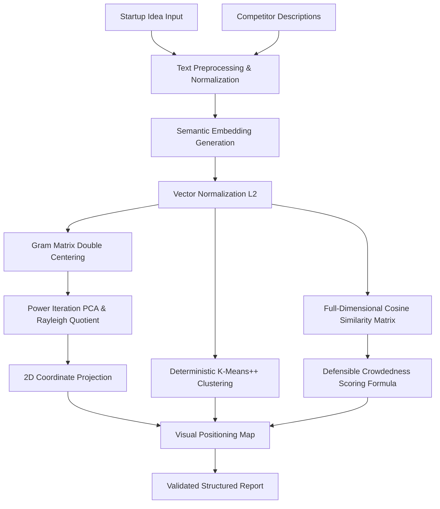

# LaunchLens Semantic Positioning Engine: Technical Architecture

## 1. System Overview

LaunchLens features a dedicated, modular Machine Learning Positioning Engine designed to map startup concepts and competitor landscapes into continuous semantic embedding spaces. Rather than relying on qualitative LLM heuristics or superficial keyword matching, LaunchLens applies quantitative linear algebra, dimensionality reduction, and clustering algorithms to evaluate competitive saturation, whitespace opportunities, and positioning coordinates.

---

## 2. Mathematical Formulations

### 2.1 Vector Representation & Normalization
Each startup idea $S$ and competitor $C_i$ is mapped to a vector in $\mathbb{R}^d$ ($d=64$ or $d=768$). Each vector $\mathbf{v}$ is strictly $L_2$-normalized:

$$\hat{\mathbf{v}} = \frac{\mathbf{v}}{\|\mathbf{v}\|_2} = \frac{\mathbf{v}}{\sqrt{\sum_{k=1}^d v_k^2}}$$

### 2.2 Full-Dimensional Cosine Similarity Ranking
Competitor ranking and relevance are evaluated strictly on the uncompressed embedding representations to preserve the full semantic manifold. The cosine similarity between the startup vector $\mathbf{s}$ and competitor vector $\mathbf{c}_i$ is:

$$\text{Sim}(\mathbf{s}, \mathbf{c}_i) = \hat{\mathbf{s}} \cdot \hat{\mathbf{c}}_i = \sum_{k=1}^d \hat{s}_k \hat{c}_{i,k} \in [-1, 1]$$

Competitors are sorted in descending order of similarity:

$$\mathbf{C}_{\text{ranked}} = \text{SortDesc}(\{\mathbf{c}_1, \dots, \mathbf{c}_n\}, \text{key}=\text{Sim}(\mathbf{s}, \mathbf{c}_i))$$

---

## 3. Dimensionality Reduction: Gram Matrix PCA

To produce faithful 2D interactive scatter visualizations while preserving pairwise Euclidean and cosine relationships, the engine implements Principal Component Analysis via Gram matrix eigendecomposition.

### 3.1 Kernel Gram Matrix Double Centering
For $N$ entities (1 startup + $n$ competitors), let matrix $\mathbf{X} \in \mathbb{R}^{N \times d}$. The inner product matrix is $\mathbf{K} = \mathbf{X} \mathbf{X}^T$.
The matrix is centered using the projection matrix $\mathbf{H} = \mathbf{I} - \frac{1}{N}\mathbf{1}\mathbf{1}^T$:

$$\mathbf{K}_{\text{centered}} = \mathbf{H} \mathbf{K} \mathbf{H} = \mathbf{K} - \frac{1}{N}\mathbf{1}\mathbf{1}^T\mathbf{K} - \frac{1}{N}\mathbf{K}\mathbf{1}\mathbf{1}^T + \frac{1}{N^2}\mathbf{1}\mathbf{1}^T\mathbf{K}\mathbf{1}\mathbf{1}^T$$

### 3.2 Power Iteration & Deflation
The dominant eigenvectors $\mathbf{v}_1, \mathbf{v}_2$ are computed via power iteration:

$$\mathbf{u}^{(t+1)} = \frac{\mathbf{K}_{\text{centered}} \mathbf{u}^{(t)}}{\|\mathbf{K}_{\text{centered}} \mathbf{u}^{(t)}\|_2}$$

Eigenvalues $\lambda_1, \lambda_2$ are extracted via the Rayleigh quotient:

$$\lambda_k = \frac{\mathbf{v}_k^T \mathbf{K}_{\text{centered}} \mathbf{v}_k}{\mathbf{v}_k^T \mathbf{v}_k}$$

After finding the first eigenvector $\mathbf{v}_1$, the matrix is deflated:

$$\mathbf{K}_{\text{deflated}} = \mathbf{K}_{\text{centered}} - \lambda_1 \mathbf{v}_1 \mathbf{v}_1^T$$

### 3.3 Explained Variance Ratio
Explained variance is measured against the trace of $\mathbf{K}_{\text{centered}}$:

$$\text{Ratio}(\text{PC}_k) = \frac{\lambda_k}{\text{Trace}(\mathbf{K}_{\text{centered}})} = \frac{\lambda_k}{\sum_{i=1}^N K_{\text{centered}, ii}}$$

---

## 4. Deterministic K-Means++ Clustering

Competitors are partitioned into structural clusters ($K=3$) using unit cosine distance:

$$D(\mathbf{x}, \mathbf{c}) = 1 - \frac{\mathbf{x} \cdot \mathbf{c}}{\|\mathbf{x}\|_2 \|\mathbf{c}\|_2}$$

1. **Initialization:** Seeded deterministic k-means++ using an explicit linear congruential generator (LCG, `seed=42`) to guarantee identical clustering results across repeated executions and CI runs.
2. **Lloyd's Iteration:** Re-assignment and centroid normalization iterating until convergence or max 20 steps.
3. **Cohesion Metric:** Cluster inertia and average pairwise intra-cluster similarity are computed to measure competitor agglomeration.

---

## 5. Defensible Market Crowdedness Formula

Market saturation is never delegated to an ungrounded LLM. It is evaluated via an explicit composite formula normalized to a $[0, 100]$ scale:

$$\text{Crowdedness} = \text{round}\Big(100 \times \big[0.45 \cdot S_{\text{top3}}^{\text{norm}} + 0.25 \cdot S_{\text{max}}^{\text{norm}} + 0.20 \cdot D_{\text{cluster}} + 0.10 \cdot C_{\text{eff}}\big]\Big)$$

Where:
- $S_{\text{top3}}^{\text{norm}} = \text{clamp}\big(\frac{\bar{S}_{\text{top3}} - 0.20}{0.75 - 0.20}, 0, 1\big)$: Average similarity of the 3 closest competitors.
- $S_{\text{max}}^{\text{norm}} = \text{clamp}\big(\frac{S_{\text{max}} - 0.20}{0.75 - 0.20}, 0, 1\big)$: Proximity of the closest direct substitute.
- $D_{\text{cluster}} \in [0, 1]$: Primary cluster concentration index.
- $C_{\text{eff}} = \min\big(1.0, \frac{\ln(1 + N)}{\ln(1 + 6)}\big)$: Competitor count saturation factor.

### Density Bands
- **0–27: Blue Ocean** (Uncontested / novel space)
- **28–49: Emerging** (Early market entry, limited direct substitutes)
- **50–69: Moderately Contested** (Established segment with identifiable whitespace)
- **70–100: Highly Crowded** (Severe saturation, direct feature parity incumbents)
- **N < 2: Insufficient Evidence** (Explicit uncertainty warning flag)
